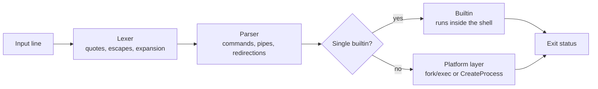

<div align="center">


<h1>shellinc</h1>

<p><strong>A small, readable command-line shell written in C, for Windows and Linux.</strong></p>

<p>
  <a href="https://github.com/2CHILON/shellinc/actions/workflows/ci.yml"></a>
  <a href="https://github.com/2CHILON/shellinc/releases"></a>
  <a href="LICENSE"></a>
  
  
</p>

<p>
  <a href="#installation">Install</a> ·
  <a href="#usage">Usage</a> ·
  <a href="#language-reference">Language reference</a> ·
  <a href="#building-from-source">Build</a> ·
  <a href="#architecture">Architecture</a> ·
  <a href="#contributing">Contributing</a>
</p>

</div>

---

## Table of contents

- [Overview](#overview)
- [Demo](#demo)
- [Installation](#installation)
- [Usage](#usage)
- [Language reference](#language-reference)
- [Platform notes](#platform-notes)
- [Building from source](#building-from-source)
- [Testing](#testing)
- [Architecture](#architecture)
- [CI and releases](#ci-and-releases)
- [Contributing](#contributing)
- [Known limitations and roadmap](#known-limitations-and-roadmap)
- [Troubleshooting](#troubleshooting)
- [License](#license)

## Overview

**shellinc** is an interactive command shell with the core features you expect from a real one: pipelines, redirection, quoting, variable expansion, builtin commands, exit statuses, and Ctrl+C handling. It runs **natively on both Windows and Linux** from a single codebase, with all operating-system differences isolated in one small platform layer.

The project is deliberately compact and readable, so it doubles as a reference for how a shell works under the hood: how a line becomes tokens, how tokens become commands, and how commands become processes connected by pipes.

**Highlights**

- **Pipelines and redirection:** `cmd1 | cmd2 | cmd3`, `<`, `>`, `>>`
- **Quoting and escaping:** single quotes, double quotes, and backslashes, with Windows paths working unquoted
- **Expansion:** `$VAR`, `${VAR}`, `$?`, and `~`, following real shell quoting rules
- **Builtins:** `cd`, `pwd`, `echo`, `export`, `unset`, `exit`, `help`
- **Proper exit statuses:** `127` for command not found, `130` after Ctrl+C, and the status of the last command in a pipeline
- **Ctrl+C that works:** it interrupts the running command, not the shell
- **Native on both platforms:** POSIX (`fork`, `exec`, `pipe`) on Linux, Win32 (`CreateProcess`, handles) on Windows
- **Tested:** unit tests, 10 end-to-end scenarios, CI on Linux and Windows, and valgrind-clean on Linux
- **Easy to install:** a Windows installer, a Windows zip, and a static Linux binary, each published with SHA-256 checksums

## Demo

An example session on Linux:

```text
$ shellinc
shellinc 0.1.0
shellinc> export GREETING=hello
shellinc> echo "$GREETING from shellinc"
hello from shellinc
shellinc> echo first > notes.txt
shellinc> echo second >> notes.txt
shellinc> cat < notes.txt | sort -r
second
first
shellinc> nosuchcommand
shellinc: nosuchcommand: command not found
shellinc> echo $?
127
shellinc> cd ~
shellinc> pwd
/home/you
shellinc> exit 3
$ echo $?
3
```

On Windows, programs are real executables, so the same ideas work with Windows tools:

```text
shellinc> git --version | findstr git
shellinc> cd ~
shellinc> pwd
C:\Users\you
```

## Installation

Download the latest build from the [Releases page](https://github.com/2CHILON/shellinc/releases). Every release contains:

| File | For |
| --- | --- |
| `shellinc-vX.Y.Z-windows-x86_64-setup.exe` | Windows installer (recommended on Windows) |
| `shellinc-vX.Y.Z-windows-x86_64.zip` | Windows, portable (no installation) |
| `shellinc-vX.Y.Z-linux-x86_64.tar.gz` | Linux x86-64, statically linked |
| `SHA256SUMS` | Checksums for all of the above |

### Windows (installer)

1. Run `shellinc-vX.Y.Z-windows-x86_64-setup.exe`.
2. Leave **Add shellinc to my PATH** ticked if you want to type `shellinc` in any terminal.
3. Open a **new** terminal window and run `shellinc`.

The installer is per-user (no administrator prompt) and installs to `%LOCALAPPDATA%\Programs\shellinc`. It adds a Start Menu shortcut and an entry in **Settings → Apps**, and uninstalling removes the files and the PATH entry.

> The installer is not code-signed, so Windows SmartScreen may show "Windows protected your PC". Click **More info**, then **Run anyway**. You can verify the download first using the [checksums](#verifying-downloads).

### Windows (portable zip)

Extract the zip anywhere and run `shellinc.exe`. It is statically linked and needs no extra DLLs.

### Linux

```bash
tar xzf shellinc-vX.Y.Z-linux-x86_64.tar.gz
sudo install -m 755 shellinc-vX.Y.Z-linux-x86_64/shellinc /usr/local/bin/shellinc
shellinc
```

Or copy the binary into any directory on your `PATH`, such as `~/.local/bin`. The binary is statically linked, so it runs on any x86-64 Linux distribution.

### Verifying downloads

Linux:

```bash
sha256sum -c SHA256SUMS --ignore-missing
```

Windows (PowerShell), then compare the output with the matching line in `SHA256SUMS`:

```powershell
Get-FileHash .\shellinc-vX.Y.Z-windows-x86_64-setup.exe -Algorithm SHA256
```

## Usage

Start the shell by running `shellinc`. It prints its version, then a `shellinc> ` prompt and waits for commands.

- Press **Enter** to run a command line.
- Press **Ctrl+C** to discard the current line, or to stop a running command.
- Type `exit` to leave. Pressing **Ctrl+D** (Linux) or **Ctrl+Z** then **Enter** (Windows) on an empty prompt also exits.
- Type `help` to list the builtin commands.

The shell reads its commands from standard input, so you can also feed it a file:

```bash
shellinc < commands.txt
```

(The prompt is still printed in this mode, and the exit status of the last command becomes the shell's exit status.)

## Language reference

### Commands, pipes, and redirection

| Syntax | Meaning |
| --- | --- |
| `cmd arg1 arg2` | Run a program or builtin with arguments |
| `cmd1 \| cmd2` | Send the output of `cmd1` to the input of `cmd2` (any number of stages) |
| `cmd < file` | Read standard input from `file` |
| `cmd > file` | Write standard output to `file`, replacing it |
| `cmd >> file` | Append standard output to `file` |

Operators are recognized even without spaces (`ls|wc>out` works). An explicit redirection overrides a pipe end. A pipeline's exit status is the status of its **last** command.

### Quoting and escaping

| Form | Meaning | Example → argument |
| --- | --- | --- |
| `'text'` | Everything literal, nothing expands | `'$HOME'` → `$HOME` |
| `"text"` | Groups words; `$` expands; `\"`, `\\` and `\$` are escapes | `"a  b"` → `a  b` |
| `\c` | Escapes a space, tab, quote, `\|`, `<`, `>`, `$`, or `\` | `a\ b` → `a b` |

Quoted pieces join adjacent text: `a"b c"d` becomes one argument, `ab cd`. Any other backslash stays as it is, so Windows paths such as `C:\Users\you` work without quoting.

### Expansion

| Form | Result |
| --- | --- |
| `$NAME`, `${NAME}` | The value of the environment variable (names are letters, digits, and `_`, not starting with a digit) |
| `$?` | The exit status of the previous command |
| `~` | The home directory, only at the start of a word and followed by nothing or a path separator (`~/src`) |

Rules worth knowing:

- Nothing expands inside single quotes. `\$` gives a literal dollar sign.
- A `$` that does not start a valid expansion stays literal (`$5`, `cost$`).
- An unquoted word that expands to nothing is dropped (`echo $UNSET x` prints `x`); a quoted one stays as an empty argument.
- Expanded text is **never re-parsed** and is not split into words. A variable containing spaces or `|` stays a single, plain argument.

### Builtin commands

| Command | Description |
| --- | --- |
| `cd [dir]` | Change directory. With no argument, go to the home directory (`HOME`, or `USERPROFILE` on Windows). |
| `pwd` | Print the current directory. |
| `echo [-n] [text...]` | Print the arguments separated by spaces. `-n` omits the trailing newline. |
| `export NAME=value...` | Set environment variables for the shell and every program it starts. |
| `unset NAME...` | Remove environment variables. |
| `exit [n]` | Exit with status `n` (0–255). Without `n`, exit with the status of the last command. |
| `help` | List the builtins. |

Builtins run inside the shell process, which is why `cd` and `export` can change the shell's own state. They honor `>` and `>>`. A builtin used inside a multi-command pipeline is looked up as an external program instead (see [limitations](#known-limitations-and-roadmap)).

### Exit statuses

| Status | Meaning |
| --- | --- |
| `0` | Success |
| `1` | A builtin or a redirection failed |
| `2` | Syntax error (unterminated quote, missing command or file name), or a bad argument to `exit` |
| `126` | The command was found but could not be run |
| `127` | Command not found |
| `128+N` | Killed by signal `N` (Linux) |
| `130` | Interrupted with Ctrl+C |

The status of the last command is available as `$?`.

## Platform notes

The two platforms behave the same wherever possible, with these differences:

- **Windows runs real programs.** Names resolve through `PATH` and need no `.exe` extension. Builtins of `cmd.exe`, such as `dir` and `type`, are not programs; run them with `cmd /c dir`.
- **Environment variables** are case-insensitive on Windows. Use `$VAR`, not `%VAR%`.
- **Home directory:** `HOME` on Linux, `USERPROFILE` on Windows.
- **End of input:** Ctrl+D on Linux, Ctrl+Z then Enter on Windows.
- **Killed by a signal** (`128+N`) exists only on Linux.

## Building from source

**Requirements:** a C11 compiler (GCC or Clang), [CMake](https://cmake.org/) 3.20 or newer, and [Ninja](https://ninja-build.org/). On Windows, use [MSYS2](https://www.msys2.org/) with the MinGW-w64 toolchain.

**Linux (Debian or Ubuntu):**

```bash
sudo apt install build-essential cmake ninja-build
git clone https://github.com/2CHILON/shellinc.git
cd shellinc
cmake -S . -B build -G Ninja
cmake --build build
./build/shellinc
```

**Windows (MSYS2 MinGW-w64):**

```bash
pacman -S mingw-w64-x86_64-gcc mingw-w64-x86_64-cmake mingw-w64-x86_64-ninja
git clone https://github.com/2CHILON/shellinc.git
cd shellinc
cmake -S . -B build -G Ninja
cmake --build build
build/shellinc.exe
```

You can run these in PowerShell too, as long as the MinGW `bin` folder is on your `PATH`.

**Release-style build** (optimized, statically linked, as published on the Releases page):

```bash
cmake -S . -B build -G Ninja -DCMAKE_BUILD_TYPE=Release -DCMAKE_EXE_LINKER_FLAGS=-static
cmake --build build
```

On Windows the build also embeds the application icon and version information into `shellinc.exe`.

## Testing

```bash
ctest --test-dir build --output-on-failure
```

| Layer | What it covers |
| --- | --- |
| Unit tests | Lexer and parser, builtins, and expansion, each in isolation |
| End-to-end tests | The real executable, fed a script on standard input, with stdout, stderr, and exit status compared against expected files: pipes, redirects, argument quoting, expansion, `cd`, exit codes, and syntax errors |

Useful variations:

```bash
ctest --test-dir build -N                                  # list all tests
ctest --test-dir build -R e2e_pipes --output-on-failure    # run one test
```

**Adding an end-to-end case** takes two files in `tests/e2e/cases/`: `name.in` (what is typed into the shell) and `name.out` (the expected stdout). Optional `name.err` and `name.code` files check stderr and the exit status. Re-run CMake and the case is picked up automatically as `e2e_name`. The tests use a small helper program, `si_tool`, so they do not depend on platform tools that differ between Windows and Linux.

**Memory checking (Linux):**

```bash
cmake -S . -B build-debug -G Ninja -DCMAKE_BUILD_TYPE=Debug
cmake --build build-debug
valgrind --leak-check=full --child-silent-after-fork=yes ./build-debug/shellinc
```

**Ctrl+C** cannot be sent from a test script, so it is checked by hand: press it at an empty prompt, with partial input typed, and while a long command is running, and confirm `$?` is `130` and the shell survives.

## Architecture

Every input line goes through the same stages:



**Source layout**

```text
shellinc/
├── include/                 Public headers
├── src/
│   ├── main.c               Entry point
│   ├── repl.c               Read-eval-print loop
│   ├── lexer.c              Tokenizing, quoting, and expansion
│   ├── parser.c             Tokens to a pipeline of commands
│   ├── builtins.c           cd, pwd, echo, export, unset, exit, help
│   ├── platform_posix.c     Linux implementation
│   └── platform_win.c       Windows implementation
├── tests/
│   ├── test_*.c             Unit tests
│   ├── helpers/si_tool.c    Helper program for end-to-end tests
│   └── e2e/                 Test cases and the CMake runner
├── installer/               Inno Setup script for the Windows installer
├── resources/               Windows resource template (icon, version info)
├── assets/icon/             Logo and application icon
└── .github/workflows/       CI and release workflows
```

**The platform layer** is the only code that differs between operating systems. Everything else is portable C11.

| Concern | Linux | Windows |
| --- | --- | --- |
| Start a process | `fork` + `execvp` | `CreateProcess` |
| Pipes and redirection | `pipe`, `dup2` | Anonymous pipes and handle inheritance |
| Wait and exit status | `waitpid` | `WaitForSingleObject` |
| Ctrl+C | `sigaction` handler | `SetConsoleCtrlHandler` |
| Directory and environment | `chdir`, `setenv` | `SetCurrentDirectory`, `_putenv_s` |

On Windows, command lines are built with the standard quoting rules, and only the handles each child needs are made inheritable, so pipes close correctly and readers see end-of-file.

## CI and releases

- **CI** (`ci.yml`): every push and pull request builds on Ubuntu and on Windows (MSYS2 MinGW-w64), runs the full test suite, and runs a smoke test of the built executable.
- **Releases** (`release.yml`): pushing a tag such as `v0.1.0` builds optimized, statically linked binaries on both platforms, runs the tests again as a gate, builds and tests the Windows installer (install, PATH entry, uninstall), writes `SHA256SUMS`, and publishes a GitHub Release with generated notes. A tag with a suffix such as `-rc.1` is published as a pre-release. A job first checks that the tag matches the version in `CMakeLists.txt`.

**To cut a release:**

1. Update `VERSION` in `CMakeLists.txt` through a pull request, if it changed.
2. Merge it, then tag the merge commit and push the tag:

```bash
git switch main && git pull
git tag v0.2.0
git push origin v0.2.0
```

## Contributing

Contributions are welcome. The workflow is:

1. Create a branch from `main` (`feat/...`, `fix/...`, `docs/...`, `test/...`, or `ci/...`).
2. Make your change, adding or updating tests for any behavior change.
3. Make sure `ctest --test-dir build --output-on-failure` passes, ideally on both platforms.
4. Open a pull request with a descriptive title in the style `feat: add ...` or `fix: handle ...`.
5. `main` is protected: CI must pass on both platforms before a pull request can be squash-merged.

Pull request titles become the commit messages on `main` and the release notes, so keep them clear. Bug reports and ideas are welcome in the [issue tracker](https://github.com/2CHILON/shellinc/issues).

## Known limitations and roadmap

**Current limitations**

- No `;`, `&&`, `||`, or background jobs (`&`), and no job control
- No `2>` or `2>&1`; redirection covers standard input and output only
- No globbing (`*.c`), no `$(...)` or backticks, and no splitting of expanded values into words
- No scripting constructs (`if`, `for`, functions); no command history, line editing, or tab completion
- A builtin inside a multi-command pipeline (`echo hi | wc`) runs as an external program of the same name: that works on Linux but not on Windows unless a matching executable is on `PATH`
- `export` with no arguments does not list variables; `~user` and `~` after `=` are not expanded
- The Windows installer is not code-signed

**Ideas for later**

- Command sequencing and conditionals (`;`, `&&`, `||`) and background jobs
- Globbing and `$(...)` command substitution
- History and line editing, then tab completion
- Builtins that work inside pipelines on Windows
- A code-signed installer and a macOS build in CI

## Troubleshooting

**Windows says "Windows protected your PC" when I run the installer.** The installer is unsigned. Click **More info**, then **Run anyway**, or verify the [checksum](#verifying-downloads) first.

**`shellinc` is not recognized after installing.** Open a **new** terminal window. Terminals that were already open do not see the updated `PATH`. If you unticked **Add shellinc to my PATH**, run `shellinc.exe` from its install folder, or re-run the installer.

**`dir` or `type` says "command not found" on Windows.** These are `cmd.exe` builtins, not programs. Use `cmd /c dir`.

**Ctrl+C at the prompt does nothing visible on Windows.** Please [open an issue](https://github.com/2CHILON/shellinc/issues) with your Windows version and the terminal you use (Windows Terminal, conhost, or the VS Code terminal).

## License

Released under the [MIT License](LICENSE).